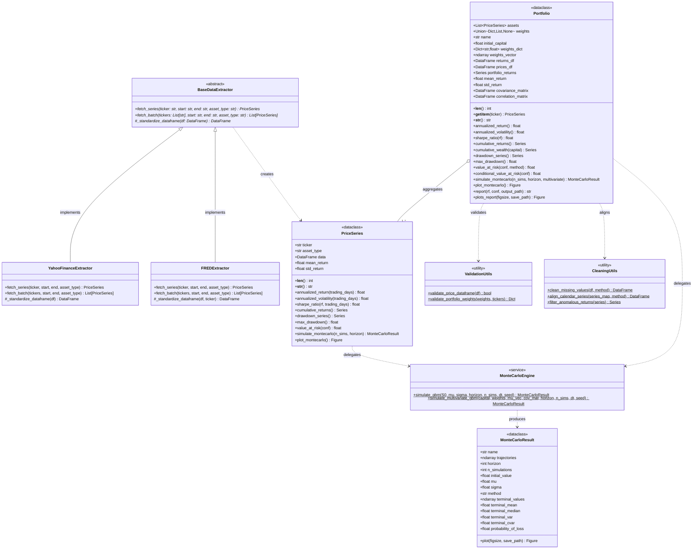
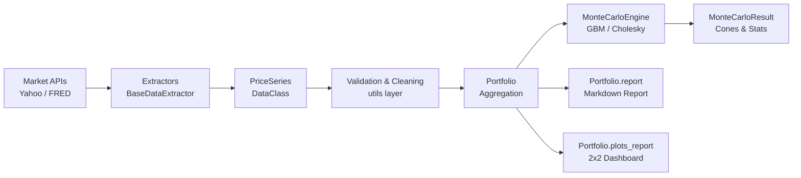

# Taller 1 — Kit de Extracción de Datos Financieros / Financial Data Extraction Toolkit

> 🇪🇸 [Español](#español) · 🇬🇧 [English](#english)

---

## Español

> **Máster MIAX BME · Edición 15**  
> Bloque B1 · Taller 1: Arquitectura, extracción de datos, modelado de carteras, simulación estocástica y reportes cuantitativos

### Descripción

Este proyecto implementa una toolbox profesional en Python para la ingesta, estandarización y análisis de información bursátil y macroeconómica, así como la gestión cuantitativa de carteras de inversión, simulación estocástica de **Monte Carlo** y generación automatizada de reportes formales (Markdown) y cuadros de mando visuales.

El diseño sigue una arquitectura modular y desacoplada mediante patrones de diseño orientados a objetos y **DataClasses**, separando estrictamente la capa de extracción de la capa de análisis, modelos, preprocesado y motores de diagnóstico y simulación estocástica.

### Estructura del repositorio taller 

```
T1/
├── doc/                                               # Guías, especificaciones y material documental del taller
│   ├── Taller_B1_T1.pdf                               # Diapositivas y enunciado oficial del taller
│   ├── architecture.md                                # Especificación técnica formal y diagramas UML/flujo
│   ├── guia_taller_parte1_git_ssh.html / .pdf         # Guía Parte 1: Configuración de Git & SSH
│   ├── guia_taller_parte2_arquitectura_extraccion.*   # Guía Parte 2: Arquitectura, entorno y capa de extracción
│   ├── guia_taller_parte3_modelado_cartera.html / .pdf# Guía Parte 3: Modelado cuantitativo y gestión de carteras
│   ├── guia_taller_parte4_monte_carlo.html / .pdf     # Guía Parte 4: Motor estocástico de Monte Carlo y difusión
│   └── guia_taller_parte5_limpieza_reportes.html /.pdf# Guía Parte 5: Preprocesado, validación y cuadro de mando
├── examples/                                          # Scripts de ejecución, pruebas y validación
│   ├── test_fetch.py                                  # Extracción individual y batch (Yahoo Finance)
│   ├── test_fetch_fred.py                             # Extracción macroeconómica (FRED)
│   ├── test_portfolio.py                              # Construcción, métricas de riesgo y diagnóstico de Cartera
│   ├── test_monte_carlo.py                            # Motor Monte Carlo univariante y multivariante (Cholesky)
│   ├── test_reports_and_cleaning.py                   # Validación fail-fast, reporte Markdown y dashboard 2x2
│   ├── plots/                                         # Gráficos generados (.png)
│   │   ├── mc_aapl.png                                # Simulación GBM individual (conos y distribución terminal)
│   │   ├── mc_portfolio_multivariate.png              # Simulación multivariante correlada (Cholesky)
│   │   ├── mc_portfolio_aggregate.png                 # Simulación agregada de cartera
│   │   └── portfolio_dashboard.png                    # Cuadro de mando 2x2 (rendimiento, drawdown, corr, VaR)
│   └── reports/                                       # Informes cuantitativos generados
│       └── portfolio_report.md                        # Informe ejecutivo exportado en Markdown
├── src/                                               # Código fuente del paquete
│   ├── setup.py                                       # Legado setuptools (no usar para instalar)
│   └── toolkit/
│       ├── __init__.py                                # Exportaciones de primer nivel
│       ├── logging_utils.py                           # Configuración idempotente de logging (setup_logging)
│       ├── reports.py                                 # Capa de presentación: informes Markdown y gráficos Matplotlib
│       ├── data/                                      # Capa de ingesta y conectores de mercado
│       │   ├── base.py                                # Interfaz abstracta (BaseDataExtractor)
│       │   ├── yahoo.py                               # Extractor Yahoo Finance (acciones/índices)
│       │   ├── fred.py                                # Extractor FRED (datos macroeconómicos + fallback CSV)
│       │   └── __init__.py
│       ├── models/                                    # Capa de modelado cuantitativo
│       │   ├── metrics.py                             # Funciones puras compartidas de rentabilidad y riesgo
│       │   ├── series.py                              # DataClass PriceSeries (series individuales)
│       │   ├── portfolio.py                           # DataClass Portfolio (agregación, riesgos, reportes)
│       │   ├── monte_carlo.py                         # Motor Monte Carlo vectorizado y DataClass MonteCarloResult
│       │   └── __init__.py
│       └── utils/                                     # Capa de limpieza, alineación y validación
│           ├── cleaning.py                            # Gestión de NaNs, forward-fill y alineación multicalendario
│           ├── validation.py                          # Validación estructural estricta de invariantes (fail-fast)
│           └── __init__.py
├── tests/                                             # Suite de tests unitarios offline (sin conexión a red)
│   └── test_toolkit.py                                # Tests ejecutables con unittest o pytest
├── pyproject.toml                                     # Configuración moderna de empaquetado pip/build/ruff/pytest
└── requirements.txt                                   # Dependencias fijadas del proyecto
```

---

### Documentación del Proyecto

El repositorio cuenta con un catálogo exhaustivo de documentación técnica y guías prácticas paso a paso disponibles en [`doc/`](doc/), generadas tanto en formato web interactivo (`HTML`) como en documentos de impresión de alta fidelidad (`PDF`, optimizados sin encabezados/pies de página de navegador):

| Documento | Formatos | Descripción y Contenidos Clave |
|---|:---:|---|
| **Enunciado y Diapositivas Oficiales** | [`PDF`](doc/Taller_B1_T1.pdf) | Requisitos formales, bloques de entrega del taller B1 y criterios de evaluación. |
| **Especificación de Arquitectura y UML** | [`Markdown`](doc/architecture.md) | Diagramas UML formales, flujo de datos por capas, patrones de diseño aplicados y contratos de interfaz. |
| **Parte 1 — Git y Configuración SSH** | [`HTML`](doc/guia_taller_parte1_git_ssh.html) · [`PDF`](doc/guia_taller_parte1_git_ssh.pdf) | Configuración de claves SSH Ed25519, vinculación con GitHub, clonación del repositorio y buenas prácticas de control de versiones. |
| **Parte 2 — Arquitectura y Extracción** | [`HTML`](doc/guia_taller_parte2_arquitectura_extraccion.html) · [`PDF`](doc/guia_taller_parte2_arquitectura_extraccion.pdf) | Configuración de virtualenv, jerarquía `BaseDataExtractor`, conectores `YahooFinanceExtractor` y `FREDExtractor`, y `PriceSeries`. |
| **Parte 3 — Modelado y Gestión de Carteras** | [`HTML`](doc/guia_taller_parte3_modelado_cartera.html) · [`PDF`](doc/guia_taller_parte3_modelado_cartera.pdf) | DataClass `Portfolio`, sincronización de calendarios, normalización de pesos, matrices estadísticas y métricas de riesgo (Sharpe, Drawdown, VaR/CVaR). |
| **Parte 4 — Motor Monte Carlo y Difusión** | [`HTML`](doc/guia_taller_parte4_monte_carlo.html) · [`PDF`](doc/guia_taller_parte4_monte_carlo.pdf) | Motor estocástico GBM, simulación multivariante con descomposición de Cholesky ($\boldsymbol{\Sigma} = \boldsymbol{L}\boldsymbol{L}^T$), percentiles y conos de trayectorias. |
| **Parte 5 — Preprocesado, Reportes y Cuadro de Mando** | [`HTML`](doc/guia_taller_parte5_limpieza_reportes.html) · [`PDF`](doc/guia_taller_parte5_limpieza_reportes.pdf) | Política de validación estricta *fail-fast*, alineación de calendarios festivos, exportación de informes Markdown y dashboard visual 2x2. |

---

### Arquitectura del Sistema y Diagramas (Requisito 4.6)

#### Diagrama de Clases UML y Jerarquía de Dependencias



#### Diagrama de Flujo de Datos



Consulte el documento extendido de diseño en [`doc/architecture.md`](doc/architecture.md).

---

### Componentes principales

#### 1. `PriceSeries` — Modelo de series temporales (`models/series.py`)

Un `dataclass` interoperable que estandariza las series de cualquier fuente de datos:

| Atributo / Método | Tipo | Descripción |
|---|---|---|
| `ticker` | `str` | Símbolo o identificador del activo (en mayúsculas) |
| `asset_type` | `str` | Clasificación semántica (`'equity'`, `'index'`, `'macro'`, etc.) |
| `data` | `pd.DataFrame` | Datos indexados por fecha con columnas `'close'` y `'returns'` |
| `mean_return` | `float` | Retorno diario medio (auto-calculado en `__post_init__`) |
| `std_return` | `float` | Desviación típica diaria (auto-calculada en `__post_init__`) |
| `__len__()` | `int` | Número de observaciones efectivas de rentabilidad |
| `annualized_return()` | `float` | Retorno anualizado compuesto geométrico ($T = 252$) |
| `annualized_volatility()` | `float` | Volatilidad anualizada ($\sigma \times \sqrt{252}$) |
| `sharpe_ratio()` | `float` | Ratio de Sharpe anualizado $(R_{ann} - R_f) / \sigma_{ann}$ |
| `max_drawdown()` | `float` | Caída máxima histórica (*Peak-to-Trough*) |
| `value_at_risk(0.95)` | `float` | VaR histórico diario al 95% de confianza |
| `simulate_montecarlo()` | `MonteCarloResult` | Simulación estocástica de trayectorias (GBM) |
| `plot_montecarlo()` | `Figure` | Genera y muestra visualmente las trayectorias y distribución |

#### 2. `Portfolio` — Modelo de Cartera de Inversión (`models/portfolio.py`)

Un `dataclass` que agrega múltiples activos `PriceSeries`, gestiona sus ponderaciones, valida los datos y calcula métricas de riesgo y rendimiento de forma automática:

| Atributo / Método | Tipo | Descripción |
|---|---|---|
| `assets` | `List[PriceSeries]` | Lista de activos que componen la cartera |
| `weights` | `Dict / List / None` | Ponderaciones (si es `None`, asigna pesos equiponderados $1/N$) |
| `weights_dict` | `Dict[str, float]` | Diccionario normalizado que suma 1.0 (auto-calculado) |
| `returns_df` | `pd.DataFrame` | Matriz alineada por fecha de retornos individuales (auto-calculado) |
| `portfolio_returns` | `pd.Series` | Serie temporal de retornos diarios de la cartera $R_p = \sum w_i R_i$ |
| `mean_return` / `std_return` | `float` | Media y volatilidad diaria de la cartera (auto-calculadas) |
| `covariance_matrix` | `pd.DataFrame` | Matriz de covarianza diaria entre activos |
| `correlation_matrix` | `pd.DataFrame` | Matriz de correlación diaria entre activos |
| `__len__()` | `int` | Número de activos integrantes de la cartera |
| `__getitem__(ticker)` | `PriceSeries` | Acceso directo indexado por clave de ticker (`portfolio['AAPL']`) |
| `annualized_return()` | `float` | Rentabilidad anualizada de la cartera |
| `annualized_volatility()` | `float` | Volatilidad anualizada de la cartera |
| `sharpe_ratio()` | `float` | Ratio de Sharpe de la cartera |
| `drawdown_series()` | `pd.Series` | Serie histórica de *drawdown* relativo al máximo acumulado |
| `max_drawdown()` | `float` | Caída máxima acumulada |
| `value_at_risk(0.95)` | `float` | Valor en Riesgo (VaR) diario al 95% (métodos `'historical'` y `'parametric'`) |
| `conditional_value_at_risk()` | `float` | CVaR / Expected Shortfall diario al 95% |
| `summary()` | `Dict[str, Any]` | Resumen exhaustivo de métricas y diagnóstico de la cartera |
| `simulate_montecarlo()` | `MonteCarloResult` | Simulación estocástica (multivariante correlada o agregada) |
| `plot_montecarlo()` | `Figure` | Visualización en pantalla de trayectorias y distribución terminal |
| `report()` | `str` (Markdown) | Genera informe formal estructurado en Markdown con diagnósticos y alertas de riesgo |
| `plots_report()` | `Figure` (Dashboard) | Genera panel gráfico 2x2: rendimiento comparado, drawdown, correlación y distribución VaR |

#### 3. Motor de Simulación Monte Carlo (`models/monte_carlo.py`)

- **`MonteCarloEngine`**: Motor estocástico con dos modelos de difusión:
  1. *Movimiento Browniano Geométrico (GBM)* univariante para activos individuales o cartera global agregada.
  2. *GBM Multivariante Correlado* para carteras mediante descomposición de Cholesky ($\boldsymbol{\Sigma} = \boldsymbol{L}\boldsymbol{L}^T$) sobre la matriz empírica de covarianzas.
- **`MonteCarloResult`**: Objeto con trayectorias ($S_t$), percentiles temporales ($5\%$, $50\%$, $95\%$), capital esperado, probabilidad de pérdida, VaR terminal y CVaR terminal monetarios.
- **Visualización integrada**: Gráficos duales con cono de trayectorias y distribución terminal con cortes de VaR.

#### 4. Preprocesado, Limpieza y Validación de Inputs (`utils/`)

- **`utils/cleaning.py`**:
  - `clean_missing_values(df, method='ffill')`: Tratamiento robusto de NaNs (forward-fill con límite de huecos para festivos bursátiles, backward-fill para el arranque o eliminación).
  - `align_calendar_series(series_map, join_method='inner')`: Sincronización temporal entre calendarios de diferentes bolsas (NYSE vs. BME).
  - `filter_anomalous_returns(series)`: Detección y filtrado de anomalías o splits no ajustados.
- **`utils/validation.py` (Política de Validación Estricta)**:
  - *Justificación*: En finanzas cuantitativas, la admisión de inputs arbitrarios corrompe las matrices de covarianza, genera división por cero en precios no positivos y distorsiona el Sharpe ratio. Por ello se aplica una política de **fallo temprano (*fail-fast*)**.
  - `validate_price_dataframe(df)`: Exige `DatetimeIndex`, orden monotónico estricto, sin duplicados temporales, presencia de columna `'close'` numérica y **precios estrictamente positivos (> 0)**.
  - `validate_portfolio_weights(weights, tickers)`: Valida dimensiones, ausencia de NaNs/infinitos, restricciones de cortos y normalización exacta a 1.0.

---

### Instalación

#### 1. Crear y activar el entorno virtual

```bash
cd T1
python -m venv .venv
source .venv/bin/activate
```

#### 2. Instalar el paquete en modo editable

Desde la raíz `T1/` (donde está `pyproject.toml`; el paquete usa *src-layout*):

```bash
pip install -e .
```

Comprobación rápida:

```bash
python -c "import toolkit; print(toolkit.__all__)"
```

O instalar las dependencias directamente:

```bash
pip install -r requirements.txt
```

---

### Ejemplos de uso

#### Ingesta, Cartera, Reporte Markdown y Dashboard Visual

```python
from toolkit.data import YahooFinanceExtractor
from toolkit.models import Portfolio

# 1. Ingesta de datos de mercado
yahoo = YahooFinanceExtractor()
assets = yahoo.fetch_batch(
    tickers=["AAPL", "MSFT", "SAN.MC", "^IBEX"],
    start="2024-01-01",
    end="2025-01-01"
)

# 2. Creación y validación de la Cartera
weights = {"AAPL": 0.40, "MSFT": 0.30, "SAN.MC": 0.15, "^IBEX": 0.15}
portfolio = Portfolio(assets=assets, weights=weights, initial_capital=100000.0)

# 3. Generación de informe cuantitativo en Markdown (.report())
md_report = portfolio.report(
    risk_free_rate=0.03,
    output_path="examples/reports/portfolio_report.md"
)
print("Informe Markdown generado con éxito.")

# 4. Generación de Dashboard visual 2x2 (.plots_report())
portfolio.plots_report(
    save_path="examples/plots/portfolio_dashboard.png",
    show=False
)
print("Dashboard gráfico de 4 paneles guardado.")

# 5. Simulación de Monte Carlo multivariante (Cholesky)
mc = portfolio.simulate_montecarlo(n_simulations=2000, horizon=252)
mc.plot(save_path="examples/plots/mc_portfolio_multivariate.png", show=False)
```

Ejecuta los scripts de prueba completos:
- `python examples/test_fetch.py`
- `python examples/test_fetch_fred.py`
- `python examples/test_portfolio.py`
- `python examples/test_monte_carlo.py`
- `python examples/test_reports_and_cleaning.py`

---

### Dependencias

| Paquete | Versión mínima | Propósito |
|---|---|---|
| `yfinance` | ≥ 0.2.36 | Descarga de acciones e índices bursátiles |
| `pandas` | ≥ 2.0.0 | Manipulación, limpieza y alineación de series temporales |
| `numpy` | ≥ 1.24.0 | Operaciones algebraicas, Cholesky y simulación vectorizada |
| `matplotlib` | ≥ 3.7.0 | Visualizaciones gráficas, dashboards analíticos y conos MC |
| `pandas-datareader` | ≥ 0.10.0 | Conexión con la API de FRED (datos macroeconómicos) |

---

## English

> **Master MIAX BME · Edition 15**  
> Block B1 · Workshop 1: Architecture, data extraction, portfolio modeling, Monte Carlo simulation and reporting

### Overview

This project implements a professional Python toolbox for fetching, standardizing, and analyzing financial and macroeconomic data, as well as quantitative investment portfolio modeling, **Monte Carlo** stochastic simulation, automated Markdown reporting, and visual diagnostics dashboards.

The architecture emphasizes clean object-oriented design and **DataClasses**, cleanly decoupling the data ingestion layer from analytical models, data pre-processing, validation, and stochastic diffusion engines.

### Repository Structure

```
T1/
├── doc/                                               # Workshop guides, formal specs & slide decks
│   ├── Taller_B1_T1.pdf                               # Assignment slides & official specification
│   ├── architecture.md                                # Formal architecture specification & UML diagrams
│   ├── guia_taller_parte1_git_ssh.html / .pdf         # Part 1 Guide: Git & SSH configuration
│   ├── guia_taller_parte2_arquitectura_extraccion.*   # Part 2 Guide: Architecture, environment & extraction
│   ├── guia_taller_parte3_modelado_cartera.html / .pdf# Part 3 Guide: Quantitative modeling & portfolio
│   ├── guia_taller_parte4_monte_carlo.html / .pdf     # Part 4 Guide: Monte Carlo engine & diffusion
│   └── guia_taller_parte5_limpieza_reportes.html /.pdf# Part 5 Guide: Preprocessing, validation & dashboard
├── examples/                                          # Execution scripts, unit tests & demonstrations
│   ├── test_fetch.py                                  # Single & batch fetch (Yahoo Finance)
│   ├── test_fetch_fred.py                             # Macro data extraction (FRED)
│   ├── test_portfolio.py                              # Portfolio creation, risk metrics & diagnostics
│   ├── test_monte_carlo.py                            # Univariate & multivariate (Cholesky) Monte Carlo
│   ├── test_reports_and_cleaning.py                   # Fail-fast validation, Markdown report & 2x2 dashboard
│   ├── plots/                                         # Exported simulation & dashboard figures (.png)
│   │   ├── mc_aapl.png                                # Single-asset GBM cone & terminal distribution
│   │   ├── mc_portfolio_multivariate.png              # Correlated multivariate Cholesky simulation
│   │   ├── mc_portfolio_aggregate.png                 # Aggregate portfolio simulation
│   │   └── portfolio_dashboard.png                    # 4-panel visual dashboard (returns, dd, corr, VaR)
│   └── reports/                                       # Exported Markdown quantitative reports
│       └── portfolio_report.md                        # Generated executive Markdown report
├── src/                                               # Package source code
│   ├── setup.py                                       # Legacy setuptools file (do not use to install)
│   └── toolkit/
│       ├── __init__.py                                # Top-level package exports
│       ├── logging_utils.py                           # Idempotent logging configuration (setup_logging)
│       ├── reports.py                                 # Presentation layer: Markdown reports & Matplotlib charts
│       ├── data/                                      # Ingestion layer & market connectors
│       │   ├── base.py                                # Abstract interface (BaseDataExtractor)
│       │   ├── yahoo.py                               # Yahoo Finance extractor (equities/indices)
│       │   ├── fred.py                                # FRED extractor (macroeconomic series + CSV fallback)
│       │   └── __init__.py
│       ├── models/                                    # Quantitative modeling layer
│       │   ├── metrics.py                             # Shared pure return & risk calculation functions
│       │   ├── series.py                              # PriceSeries DataClass (single asset series)
│       │   ├── portfolio.py                           # Portfolio DataClass (aggregation, risk, reports)
│       │   ├── monte_carlo.py                         # Vectorized Monte Carlo engine & MonteCarloResult DataClass
│       │   └── __init__.py
│       └── utils/                                     # Data cleaning, calendar alignment & validation
│           ├── cleaning.py                            # Missing value imputation & multi-exchange alignment
│           ├── validation.py                          # Strict structural invariant enforcement (fail-fast)
│           └── __init__.py
├── tests/                                             # Offline unit test suite (no network required)
│   └── test_toolkit.py                                # Runnable with unittest or pytest
├── pyproject.toml                                     # Modern build system, ruff & pytest configuration
└── requirements.txt                                   # Pinned dependency requirements
```

---

### Project Documentation

The repository features an exhaustive documentation suite and step-by-step technical guides located in [`doc/`](doc/), distributed in both interactive web format (`HTML`) and high-fidelity print documents (`PDF`, optimized without browser header/footer artifacts):

| Document | Formats | Overview & Core Topics |
|---|:---:|---|
| **Official Assignment & Slide Deck** | [`PDF`](doc/Taller_B1_T1.pdf) | Formal workshop requirements, assignment blocks, and academic evaluation criteria. |
| **Architecture & Formal UML Specification** | [`Markdown`](doc/architecture.md) | Formal UML class diagrams, layered dataflow, design patterns, and interface contracts. |
| **Part 1 — Git & SSH Configuration** | [`HTML`](doc/guia_taller_parte1_git_ssh.html) · [`PDF`](doc/guia_taller_parte1_git_ssh.pdf) | Ed25519 SSH key generation, GitHub linkage, repository cloning, and version control best practices. |
| **Part 2 — Architecture, Environment & Extraction** | [`HTML`](doc/guia_taller_parte2_arquitectura_extraccion.html) · [`PDF`](doc/guia_taller_parte2_arquitectura_extraccion.pdf) | Virtualenv setup, `BaseDataExtractor` abstract hierarchy, `YahooFinanceExtractor`, `FREDExtractor`, and `PriceSeries`. |
| **Part 3 — Quantitative Modeling & Portfolio Management** | [`HTML`](doc/guia_taller_parte3_modelado_cartera.html) · [`PDF`](doc/guia_taller_parte3_modelado_cartera.pdf) | `Portfolio` DataClass, multi-calendar alignment, weight normalization, covariance/correlation matrices, and risk metrics (Sharpe, Drawdown, VaR/CVaR). |
| **Part 4 — Monte Carlo Engine & Diffusion** | [`HTML`](doc/guia_taller_parte4_monte_carlo.html) · [`PDF`](doc/guia_taller_parte4_monte_carlo.pdf) | Stochastic GBM engine, correlated multivariate simulation via Cholesky decomposition ($\boldsymbol{\Sigma} = \boldsymbol{L}\boldsymbol{L}^T$), percentiles, and cones. |
| **Part 5 — Preprocessing, Validation & Dashboard** | [`HTML`](doc/guia_taller_parte5_limpieza_reportes.html) · [`PDF`](doc/guia_taller_parte5_limpieza_reportes.pdf) | Strict fail-fast invariant validation, trading holiday calendar alignment, automated Markdown reporting, and 2x2 visual dashboard. |

---

### System Architecture & Diagrams (Requirement 4.6)

#### UML Class Diagram & Dependencies


#### Layered Data Flow Diagram


See the extended architecture document in [`doc/architecture.md`](doc/architecture.md).

---

### Key Components

#### 1. `PriceSeries` — Single Asset Data Model (`models/series.py`)

A standardized `dataclass` modeling price series from any source:

| Attribute / Method | Type | Description |
|---|---|---|
| `ticker` | `str` | Asset symbol (uppercased) |
| `asset_type` | `str` | Semantic type (`'equity'`, `'index'`, `'macro'`, etc.) |
| `data` | `pd.DataFrame` | Date-indexed DataFrame with `'close'` and `'returns'` |
| `mean_return` | `float` | Daily mean return (auto-computed in `__post_init__`) |
| `std_return` | `float` | Daily return standard deviation (auto-computed in `__post_init__`) |
| `__len__()` | `int` | Number of observations in the return series |
| `annualized_return()` | `float` | Compound annualized return ($T = 252$) |
| `annualized_volatility()` | `float` | Annualized volatility ($\sigma \times \sqrt{252}$) |
| `sharpe_ratio()` | `float` | Annualized Sharpe ratio $(R_{ann} - R_f) / \sigma_{ann}$ |
| `max_drawdown()` | `float` | Maximum peak-to-trough drawdown |
| `value_at_risk(0.95)` | `float` | Daily historical 95% Value at Risk |
| `simulate_montecarlo()` | `MonteCarloResult` | Stochastic trajectory simulation (GBM) |
| `plot_montecarlo()` | `Figure` | Trajectory and terminal distribution visualization |

#### 2. `Portfolio` — Investment Portfolio Model (`models/portfolio.py`)

A `dataclass` aggregating multiple `PriceSeries` assets, managing weights, validating inputs, and automatically computing statistical and risk metrics:

| Attribute / Method | Type | Description |
|---|---|---|
| `assets` | `List[PriceSeries]` | List of asset series in the portfolio |
| `weights` | `Dict / List / None` | Allocations (defaults to equal weighting $1/N$ if `None`) |
| `weights_dict` | `Dict[str, float]` | Normalized weight dictionary summing to 1.0 |
| `returns_df` | `pd.DataFrame` | Aligned daily return matrix across all assets |
| `portfolio_returns` | `pd.Series` | Daily portfolio return series $R_p = \sum w_i R_i$ |
| `mean_return` / `std_return` | `float` | Daily mean and volatility of portfolio returns |
| `covariance_matrix` | `pd.DataFrame` | Daily return covariance matrix |
| `correlation_matrix` | `pd.DataFrame` | Daily return correlation matrix |
| `__len__()` | `int` | Number of constituent assets |
| `__getitem__(ticker)` | `PriceSeries` | Direct indexing access by ticker (`portfolio['AAPL']`) |
| `annualized_return()` | `float` | Annualized portfolio return |
| `annualized_volatility()` | `float` | Annualized portfolio volatility |
| `sharpe_ratio()` | `float` | Annualized Sharpe ratio |
| `drawdown_series()` | `pd.Series` | Underwater drawdown series relative to cumulative peak |
| `max_drawdown()` | `float` | Maximum portfolio drawdown |
| `value_at_risk(0.95)` | `float` | Daily 95% Value at Risk (`'historical'` and `'parametric'`) |
| `conditional_value_at_risk()` | `float` | Daily 95% CVaR / Expected Shortfall |
| `summary()` | `Dict[str, Any]` | Comprehensive portfolio metric summary |
| `simulate_montecarlo()` | `MonteCarloResult` | Stochastic simulation (multivariate correlated or aggregate) |
| `plot_montecarlo()` | `Figure` | Screen rendering of trajectories and terminal distribution |
| `report()` | `str` (Markdown) | Generates structured Markdown report with executive summary & risk flags |
| `plots_report()` | `Figure` (Dashboard) | Generates 2x2 visual dashboard: relative growth, drawdown, correlation & return distribution |

#### 3. Monte Carlo Simulation Engine (`models/monte_carlo.py`)

- **`MonteCarloEngine`**: Stochastic simulation engine featuring:
  1. *Geometric Brownian Motion (GBM)* for single assets or aggregate portfolio drift/volatility.
  2. *Correlated Multivariate GBM* utilizing Cholesky decomposition of the empirical asset covariance matrix ($\boldsymbol{\Sigma} = \boldsymbol{L}\boldsymbol{L}^T$).
- **`MonteCarloResult`**: Container class storing full path trajectories ($S_t$), percentiles ($5\%$, $50\%$, $95\%$), expected capital, probability of loss, monetary terminal VaR, and terminal CVaR.

#### 4. Preprocessing, Cleaning & Input Validation (`utils/`)

- **`utils/cleaning.py`**:
  - `clean_missing_values(df, method='ffill')`: Missing value imputation with forward-fill limits suited for market holidays.
  - `align_calendar_series(series_map, join_method='inner')`: Synchronizes differing trading calendars across exchanges.
- **`utils/validation.py` (Strict Input Policy)**:
  - *Justification*: Unconstrained inputs cause silent failures in quantitative finance (e.g., negative prices producing NaN returns, non-positive definite covariances). Strict validation enforces fail-fast integrity.
  - `validate_price_dataframe(df)`: Enforces `DatetimeIndex`, monotonic order, uniqueness, required numeric `'close'`, and strictly positive prices.
  - `validate_portfolio_weights(weights, tickers)`: Enforces dimension match, finite values, short constraints, and exact normalization.

---

### Installation

```bash
cd T1
python -m venv .venv
source .venv/bin/activate
pip install -e .          # run from T1/ (pyproject.toml, src-layout)
```

### Usage

```python
from toolkit.data import YahooFinanceExtractor
from toolkit.models import Portfolio

yahoo = YahooFinanceExtractor()
assets = yahoo.fetch_batch(["AAPL", "MSFT", "SAN.MC"], start="2024-01-01", end="2025-01-01")

portfolio = Portfolio(assets=assets, weights={"AAPL": 0.5, "MSFT": 0.3, "SAN.MC": 0.2})

# 1. Generate Markdown Report
report_md = portfolio.report(risk_free_rate=0.03, output_path="examples/reports/portfolio_report.md")

# 2. Generate 4-panel visual dashboard
portfolio.plots_report(save_path="examples/plots/portfolio_dashboard.png", show=False)
```

Run test examples:
- `python examples/test_fetch.py`
- `python examples/test_fetch_fred.py`
- `python examples/test_portfolio.py`
- `python examples/test_monte_carlo.py`
- `python examples/test_reports_and_cleaning.py`

### Dependencies

| Package | Min. Version | Purpose |
|---|---|---|
| `yfinance` | ≥ 0.2.36 | Equity and index price data |
| `pandas` | ≥ 2.0.0 | Time series alignment and data manipulation |
| `numpy` | ≥ 1.24.0 | Vectorized algebra, Cholesky decomposition, and simulations |
| `matplotlib` | ≥ 3.7.0 | Plotting trajectories, distributions, and analytics dashboard |
| `pandas-datareader` | ≥ 0.10.0 | FRED macroeconomic API client |

---

*MIAX - Máster en Inteligencia Artificial Aplicada a Mercados Financieros (Instituto BME).*
